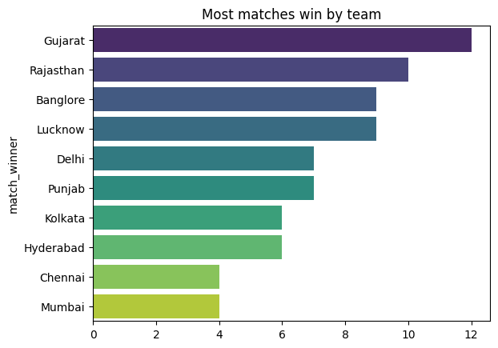
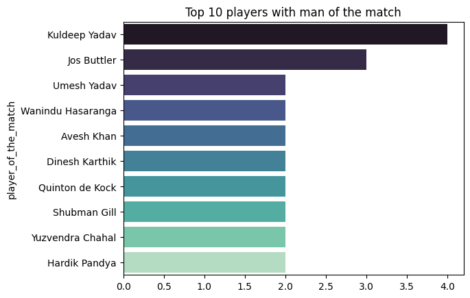
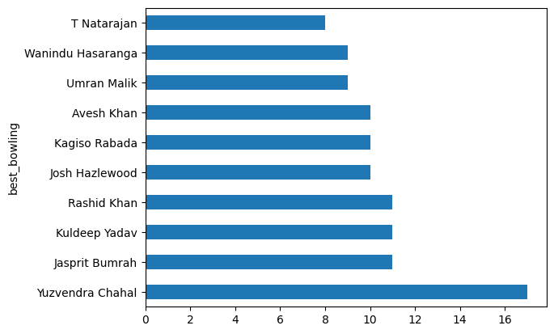
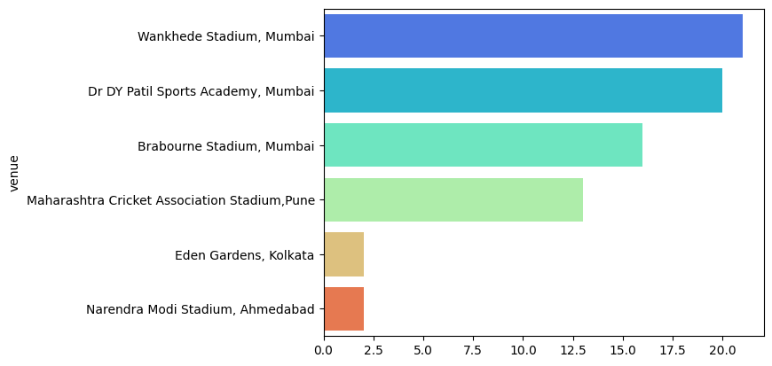

# IPL 2022 Match Analysis

An exploratory data analysis project and interactive dashboard built around 74 IPL 2022 match records. The project studies team results, toss decisions, player awards, bowling figures and venues using Python.

## Dataset

The project uses the included \`IPL.csv\` file. Each row represents one match.

| Detail | Count |
|---|---:|
| Matches | 74 |
| Teams | 10 |
| Venues | 6 |
| Group-stage matches | 70 |
| Playoff matches | 3 |
| Final | 1 |

The dataset contains 20 columns covering match details, participating teams, toss information, innings scores, match results, Player of the Match, top scorer and the best bowling figure recorded for each match.

| Column group | Fields | What it tells us |
|---|---|---|
| Match information | \`match_id\`, \`date\`, \`stage\`, \`venue\` | When and where the match was played |
| Teams and toss | \`team1\`, \`team2\`, \`toss_winner\`, \`toss_decision\` | Teams participating and their toss choice |
| Innings | \`first_ings_score\`, \`first_ings_wkts\`, \`second_ings_score\`, \`second_ings_wkts\` | Runs and wickets in both innings |
| Result | \`match_winner\`, \`won_by\`, \`margin\` | Winning team, result type and margin |
| Player performance | \`player_of_the_match\`, \`top_scorer\`, \`highscore\`, \`best_bowling\`, \`best_bowling_figure\` | Notable batting, bowling and player award details |

## How the data is analysed

Pandas is used to load and inspect the CSV, count categories, group records and prepare values for charts. Matplotlib and Seaborn are used in the notebook; the Streamlit dashboard uses interactive Plotly charts.

| Analysis | Method | Question |
|---|---|---|
| Team results | Count values in \`match_winner\` | Which teams won the most matches? |
| Result types | Count values in \`won_by\` | Were matches more often won by runs or wickets? |
| Toss trends | Count values in \`toss_decision\` | Did teams choose to bat or field? |
| Toss and match result | Compare \`toss_winner\` with \`match_winner\` | How often did the toss winner also win the match? |
| Player awards | Count \`player_of_the_match\` | Which players received the most awards? |
| Batting | Review \`top_scorer\` and \`highscore\` | What were the highest recorded individual scores? |
| Bowling | Extract the wicket count from figures such as \`3--20\`, then group by bowler | Which bowlers appear most often in strong match-level figures? |
| Venues | Count values in \`venue\` | Which grounds hosted the most matches? |
| Innings scores | Compare first- and second-innings scores | How do innings totals compare? |

### Workflow

1. Load \`IPL.csv\` into a Pandas DataFrame.
2. Inspect the dimensions, columns, data types and missing values.
3. Standardise the Bangalore team spelling in the dashboard.
4. Extract the wicket count from the recorded bowling figure.
5. Aggregate records by team, player, result and venue.
6. Visualise the summaries with bar, pie and scatter charts.
7. Use dashboard filters to inspect a selected stage, team or venue.

## Findings in this dataset

These descriptive results are calculated from the 74 records in \`IPL.csv\`:

- **Gujarat** recorded the most wins (**12**), followed by Rajasthan (**10**).
- Results were evenly split: **37 wins by runs** and **37 wins by wickets**.
- Teams elected to field first in **59 matches** and bat first in **15**.
- The toss winner also won **36 of 74 matches (48.6%)**.
- **Kuldeep Yadav** received the most Player of the Match awards (**4**), followed by Jos Buttler (**3**).
- **Wankhede Stadium, Mumbai** hosted the most matches (**21**).
- The highest individual score in the \`highscore\` field was **140**, recorded by Quinton de Kock.
- The largest win by runs was Chennai's **91-run** victory.

These are descriptive observations from the supplied records. They do not establish that winning the toss caused a match result.

## Interactive dashboard

Run the dashboard to explore four sections:

- **Team performance:** wins by team and results by runs or wickets.
- **Player performance:** Player of the Match awards and match-level bowling figures.
- **Match patterns:** toss decisions and first- versus second-innings scores.
- **Venues:** matches hosted by each venue.

The sidebar filters the dashboard by tournament stage, team and venue.

### Chart previews

| Team wins | Player awards |
|---|---|
|  |  |

| Bowling figures | Matches by venue |
|---|---|
|  |  |

## Run locally

~~~bash
cd IPL-2022-Analysis
python3 -m venv .venv
source .venv/bin/activate
pip install -r requirements.txt
streamlit run app.py
~~~

Open the local URL printed by Streamlit.

To work with the notebook, start Jupyter from this project folder:

~~~bash
jupyter lab
~~~

Then open \`notebooks/IPL-2022-Analysis.ipynb\`.

## Project files

- \`app.py\` — interactive Streamlit dashboard
- \`IPL.csv\` — IPL 2022 match-level dataset
- \`notebooks/IPL-2022-Analysis.ipynb\` — exploratory analysis
- \`images/\` — chart previews used in this README
- \`requirements.txt\` — project dependencies

## Limitations

- The file contains match summaries, not ball-by-ball data or complete player season statistics.
- Bowling comparisons are based on each match's recorded best bowling figure. Summing these wickets is not the same as a player's season wicket total.
- The \`highscore\` field records the top scorer's score per match; it should not be summed as an official season run total.
