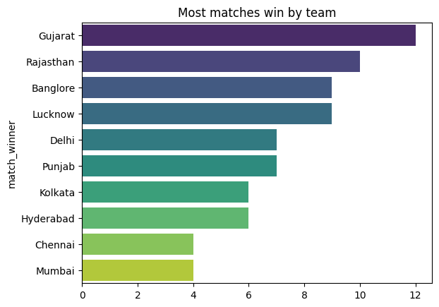
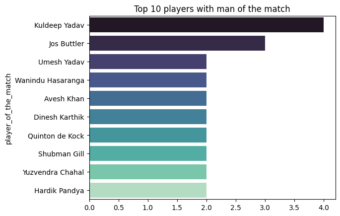
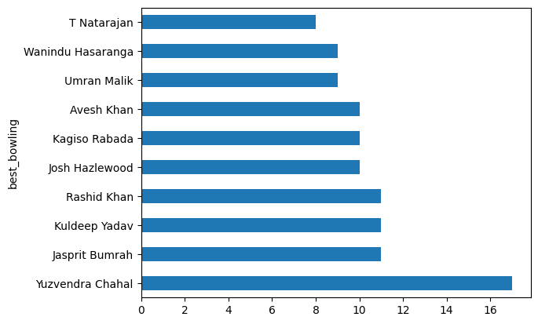
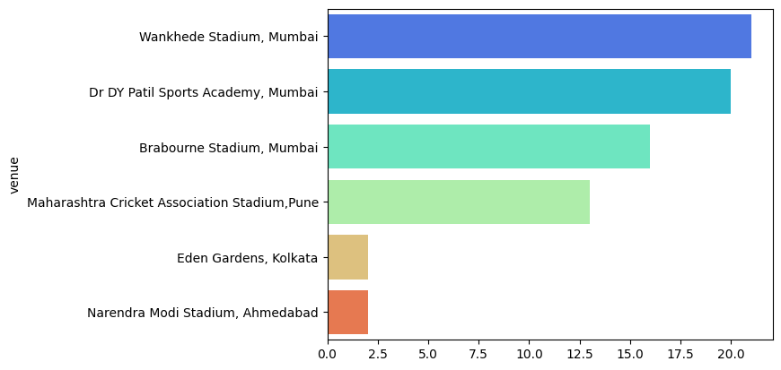

# IPL 2022 Data Visualisation

An interactive dashboard and a set of Jupyter notebooks for exploring IPL 2022 match data with Python.

## Visualisations

| Team wins | Player of the Match awards |
|---|---|
|  |  |

| Bowling figures | Matches by venue |
|---|---|
|  |  |

## Run the dashboard

~~~bash
python -m venv .venv
source .venv/bin/activate
pip install -r requirements.txt
streamlit run app.py
~~~

Open the local URL printed by Streamlit. Use the sidebar to filter by stage, team and venue.

## Notebooks

The notebooks cover Matplotlib, Seaborn distribution and categorical plots, matrix plots, regression plots, Plotly, and the IPL 2022 analysis.

Open the notebooks with:

~~~bash
jupyter lab
~~~

## Project files

- \`app.py\` — interactive IPL dashboard
- \`IPL.csv\` — IPL 2022 match dataset (74 matches)
- \`IPL_PROJECT.ipynb\` — IPL analysis notebook
- \`1.Matplotlib.ipynb\` to \`5. Plotly and cufflinks.ipynb\` — visualisation examples
- \`images/\` — chart images used in this README
- \`requirements.txt\` — Python dependencies
