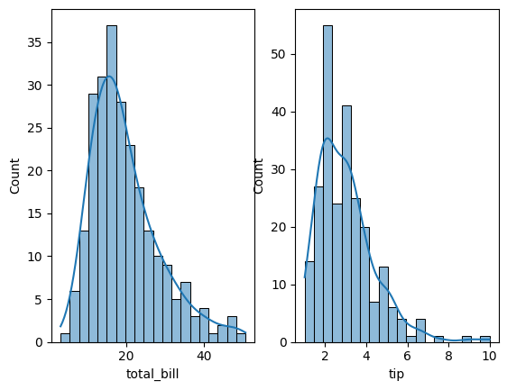
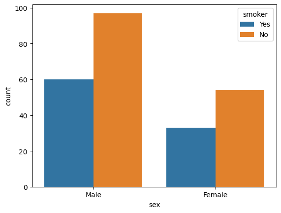
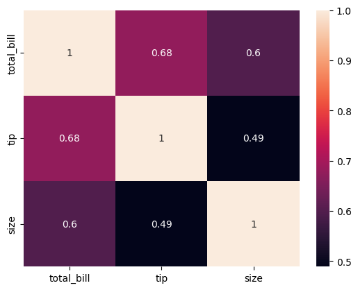
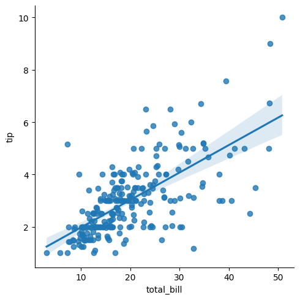

# Tips Dataset Analysis

A hands-on data visualisation project using Python, Pandas, Matplotlib, Seaborn and Plotly. It explores restaurant bills and tips, then uses different chart types to understand distributions, categories, correlations and relationships between variables.

## Dataset

The main dataset is \`data/tips.csv\`, a sample dataset distributed with Seaborn's example datasets. It contains **244 dining bills and 7 columns**.

| Column | Description |
|---|---|
| \`total_bill\` | Total restaurant bill |
| \`tip\` | Tip amount |
| \`sex\` | Recorded sex category for the bill payer |
| \`smoker\` | Whether the party included a smoker |
| \`day\` | Day of the week |
| \`time\` | Lunch or dinner |
| \`size\` | Number of people in the dining party |

The matrix-plot notebook also uses \`data/flights.csv\` for a year-by-month heatmap example. It contains 144 monthly passenger observations and is a supporting visualisation dataset, not part of the main tips analysis.

Both CSV files are included locally, so notebooks do not need to download Seaborn datasets at runtime.

## What we explore

| Topic | Charts | What we investigate |
|---|---|---|
| Distribution | Histogram, KDE, joint plot, pair plot, rug plot | How bills and tips are distributed and how two numeric variables vary together |
| Categorical comparison | Count plot, bar plot, box plot, violin plot, strip plot, swarm plot | How bills and tips vary across day, time, smoker and party categories |
| Matrix analysis | Correlation heatmap, clustermap, pivot-table heatmap | Correlation between numeric columns and monthly passenger patterns in the supporting flights data |
| Regression | Regression plot (\`lmplot\`) | The relationship between total bill and tip, including category comparisons |
| Interactive plotting | Plotly scatter and bar charts | Bill-versus-tip points and average tip by day with hover details |
| Plotting fundamentals | Line, scatter, histogram, box plot, subplots and image display | Core Matplotlib figure and axes operations |

## Analysis workflow

1. Read the local CSV files into Pandas DataFrames.
2. Inspect columns, unique categories and basic distributions.
3. Use histograms and KDE curves to understand numeric variables.
4. Compare categories using count, bar and distribution plots.
5. Calculate correlations for selected numeric columns and display them as heatmaps.
6. Use regression plots to visualise the bill-tip relationship.
7. Build interactive Plotly charts for more detailed exploration.

## Findings from the tips sample

The following values are calculated from the 244 rows in \`data/tips.csv\`:

- Average total bill: **$19.79**.
- Average tip: **$3.00**.
- Average tip is approximately **15.2%** of the average bill.
- The correlation between total bill and tip is approximately **0.676**, indicating a positive association in this sample.
- Sunday has the highest average tip (**$3.26**) among the four recorded days.
- The average dinner tip (**$3.10**) is higher than the average lunch tip (**$2.73**) in this sample.

These are descriptive statistics for this sample dataset. Correlation does not show that a higher bill causes a higher tip, and the results should not be generalised to all restaurants.

## Visualisation previews

| Distribution plots | Categorical comparison |
|---|---|
|  |  |

| Correlation heatmap | Regression plot |
|---|---|
|  |  |

## Run locally

~~~bash
cd Tips-Dataset-Analysis
python3 -m venv .venv
source .venv/bin/activate
pip install -r requirements.txt
jupyter lab
~~~

Open the notebooks in the \`notebooks/\` folder. Start Jupyter from the \`Tips-Dataset-Analysis\` folder so the relative paths to \`data/\` and \`assets/\` work correctly.

## Notebook guide

1. \`01-Matplotlib-Fundamentals.ipynb\` — figure creation, axes, subplots, plot styles, saving charts and displaying images.
2. \`02-Distribution-Plots.ipynb\` — histograms, KDE, joint plots, pair plots and rug plots.
3. \`03-Categorical-Plots.ipynb\` — count, bar, box, violin, strip and swarm plots.
4. \`04-Matrix-Plots.ipynb\` — correlation matrix, heatmap, clustermap and pivot-table heatmap.
5. \`05-Regression-Plots.ipynb\` — regression plots and category comparisons.
6. \`06-Plotly.ipynb\` — interactive scatter and bar charts.

## Tools

Python, Pandas, NumPy, Matplotlib, Seaborn, Plotly and Jupyter Notebook.

## Dataset source

The sample CSV files are from the [Seaborn example datasets repository](https://github.com/mwaskom/seaborn-data).
